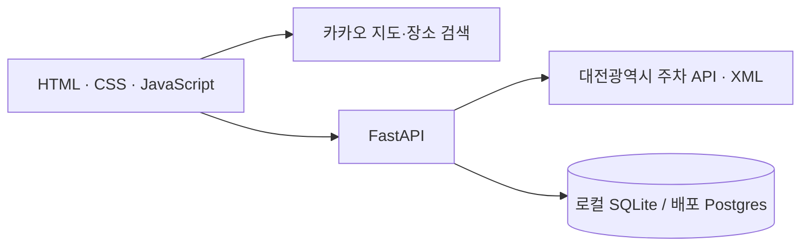

<div align="center">

# 🅿️ 차대유~
### 주차할 데 찾으슈? 언제 확인한 자리인지도 봐유.

**대전 주차장, 헤매지 말고 차대유~**

지도에서 목적지를 찾고, 주변 주차장의 빈자리와 요금을 확인하세요.


[](https://daejeon-chadaeu-parking.vercel.app/)

**🌐 [서비스 이용하기](https://daejeon-chadaeu-parking.vercel.app/) · [공개 심사 화면](https://daejeon-chadaeu-parking.vercel.app/review) · [소스 코드](https://github.com/Dong-DDack/Daejeon-ChaDaeU-Parking)**

[주요 기능](#주요-기능) · [로컬 실행](#로컬-실행) · [Vercel 배포](#vercel-배포) · [데이터 안내](#데이터-안내)

</div>

---

## 프로젝트 소개

**차대유~**는 충청도 말투의 친근함을 담은 대전 주차 정보 서비스입니다. 목적지 주변의 주차장을 지도에서 찾고, 요금과 운영시간, 제공되는 빈자리 정보를 함께 확인할 수 있습니다.

숫자만 보여 주는 대신 **언제 조회한 정보인지, 현재 확인할 수 있는 값인지**도 설명합니다. 외부 데이터 조회가 실패해도 마지막 정상값을 보존하고, 오래된 정보임을 표시해 사용자가 판단할 수 있도록 했습니다.

| 프로젝트 | 차대유~ · Daejeon ChaDaeU Parking |
| :--- | :--- |
| 서비스 주소 | [daejeon-chadaeu-parking.vercel.app](https://daejeon-chadaeu-parking.vercel.app/) |
| 대상 지역 | 대전광역시 · 원천 데이터가 제공되는 주차장 |
| 화면 구성 | 지도 + 주차장 목록 + 상세 정보 + 일별 기록 |
| 디자인 | 파란색 `#2870F3`와 반응형 화면 |

> 대전에서 정보 들어오는 주차장만 보여드려유. 도착하실 땐 빈자리가 달라질 수도 있어유.

## 주요 기능

| 기능 | 설명 |
| :--- | :--- |
| 🗺️ 주변 탐색 | 장소 검색 후 직선거리 반경 3km의 주차장을 표시합니다. |
| 📍 지도 상세 카드 | 마커나 목록을 누르면 지도 안에서 요금·운영시간·조회 시각을 확인합니다. |
| 🔎 조건별 검색 | 주차장명·주소·행정구·빈자리 여부·현재 지도 영역으로 좁힙니다. |
| 🚙 상태별 표시 | 목록은 **빈자리 → 확인 필요 → 만차** 순입니다. 지도 마커는 가용 정보가 있는 곳만 표시합니다. |
| 🕘 마지막 정상값 보존 | 조회가 실패해도 이전 정상값을 지우지 않고 정보 지연을 표시합니다. |
| 📅 일별 기록 | KST 날짜별 마지막 성공값을 저장하고 직전 기록과의 차이를 계산합니다. |

## 사용 방법

먼저 **[차대유~에 접속](https://daejeon-chadaeu-parking.vercel.app/)**하세요.

1. **목적지 검색** — 대전역·둔산동 등 장소 또는 주차장 이름을 입력합니다.
2. **주변 정보 확인** — 지도 마커와 정렬된 목록에서 주차장을 선택합니다.
3. **상세 정보 확인** — 요금·운영시간·가용 대수와 마지막 조회 시각을 확인합니다.

최신 데이터를 받고 싶다면 **다시 조회**를 누르세요. 원천 호출을 줄이기 위해 최근 60초의 정상 결과를 재사용합니다.

## 공개 심사 화면

**[차대유~ /review](https://daejeon-chadaeu-parking.vercel.app/review)**에서 로그인 없이 확인할 수 있습니다.

- 공식 패키지 `aleph-t04-real-information-board-public-contract-v2`의 17개 파일 SHA-256·바이트 수 대조
- 공식 9개 fixture 기반 정상·실패·복구 재생과 9개 시나리오 자동 검증
- 같은 날짜 record ID 유지, 다섯 실패 후 105/1행 보존, 복구 후 120/2행·변화 15 확인
- 실제 원천 필드·정규화 저장값·화면값, 선택한 두 날짜의 변화 대조

‘C19 실패 시작 상태’ → ‘다시 시도’를 누르면 `stale / timeout`, 값 105, 1행에서 `fresh / none`, 값 120, 2행으로 바뀝니다. 복구를 반복해도 다음 날짜 행은 1건입니다. 합성 시험은 브라우저 탭의 fixture ID 순서로만 보존되고 서버에서 매번 공식 입력으로 재구성합니다. 실제 DB는 변경하지 않습니다.

실제·합성 경로는 공통 `readings.py`의 검증·일별 행 생성 함수를 사용합니다. 기존 실제 기록은 변경하지 않으며, 새 성공 조회부터 정규화 행을 함께 저장합니다. 과거 행을 정규화해 표시하는 경우 `legacy_normalized_view`로 구분합니다.

플랫폼의 `t04_day` 봉인 영수증을 자체 발급하지 않습니다. 실제 원천 시각(C07)·서로 다른 실제 날짜의 영수증 2건은 별도 확인이 필요합니다.

## 기술 구성



| 영역 | 구성 |
| :--- | :--- |
| 화면 | HTML, CSS, JavaScript · Primary `rgb(40, 112, 243)` |
| 지도·장소 검색 | Kakao Maps JavaScript SDK |
| 서버 | FastAPI, httpx |
| 데이터 처리 | XML 정규화, 전체 페이지 조회, 오류 상태 분류 |
| 저장 | 로컬 SQLite / 운영 Postgres |
| 배포 | Vercel · [Production 서비스](https://daejeon-chadaeu-parking.vercel.app/) |

## 로컬 실행

**Python 3.11 이상**이 필요합니다. Windows PowerShell 기준입니다.

```powershell
git clone https://github.com/Dong-DDack/Daejeon-ChaDaeU-Parking.git
cd Daejeon-ChaDaeU-Parking
py -m venv .venv
.\.venv\Scripts\python.exe -m pip install -r requirements.txt
Copy-Item .env.example .env
```

`.env`에 키를 입력한 뒤 서버를 실행합니다. 기존 `.env`는 예시 파일로 덮어쓰지 마세요.

```powershell
.\.venv\Scripts\python.exe -m uvicorn app:app --reload
```

브라우저에서 **http://127.0.0.1:8000**을 엽니다. 종료는 `Ctrl+C`입니다. HTML 파일을 직접 열면 서버 기능은 작동하지 않습니다.

### 환경변수

```dotenv
KAKAO_JAVASCRIPT_KEY=
DAEJEON_PARKING_API_KEY=
DATABASE_URL=
```

| 이름 | 입력 값 | 관리 방법 |
| :--- | :--- | :--- |
| `KAKAO_JAVASCRIPT_KEY` | 카카오 **JavaScript 키** | 브라우저용 공개 키. 허용 도메인 등록 |
| `DAEJEON_PARKING_API_KEY` | 공공데이터포털 **Decoding 인증키** | 서버에서만 사용 |
| `DATABASE_URL` | Postgres 연결 문자열 | 서버에서만 사용. 로컬은 비워두면 SQLite 사용 |

`.env`, 로컬 DB, 설치된 패키지는 Git에서 제외합니다. 실제 인증키를 소스에 적거나 저장소에 올리지 마세요.

### 카카오 지도 설정

**앱 → 플랫폼 키 → JavaScript 키 → JavaScript SDK 도메인**에 아래 주소를 등록합니다.

```text
http://127.0.0.1:8000
http://localhost:8000
```

**제품 링크 관리의 웹 도메인과는 별도 설정입니다.** 카카오맵 사용 설정도 확인하세요. 어드민·REST 키는 지도용 JavaScript 키로 쓸 수 없습니다. `.env` 변경 후에는 서버를 종료하고 다시 실행하세요.

## Vercel 배포

1. **Add New → Project**에서 이 저장소를 Import합니다.
2. **Root Directory는 기본값 `.`**을 사용합니다. FastAPI 감지를 확인하고 Build Command·Output Directory는 기본값을 유지합니다.
3. **Environment Variables**에 카카오 JS 키와 대전 인증키를 등록합니다. 서버 비밀값은 Secret으로 관리합니다.
4. 외부 Postgres DB를 연결하고 연결 문자열을 **`DATABASE_URL`**로 등록합니다. Neon 등의 DB를 연결할 수 있습니다. 테이블은 첫 요청 시 생성되므로 생성 권한이 필요합니다.
5. **Deploy** 후 실제 Production 주소를 카카오 **JavaScript SDK 도메인**에 추가합니다.
6. 환경변수를 나중에 변경하면 **Redeploy**합니다. 공개 주소가 시크릿 창에서도 로그인 없이 열리는지 확인합니다.

> **Vercel에서는 `DATABASE_URL`이 필수입니다.** 서버의 로컬 파일을 영구 기록 저장소로 사용하지 않습니다. DB가 없거나 연결에 실패하면 저장소 오류를 표시합니다.

## 데이터 안내

원천은 [대전광역시 실시간 주차장 정보](https://www.data.go.kr/data/15083717/openapi.do)입니다. `parkinglotIF` XML 응답을 페이지당 50건씩 조회합니다.

- **제공 목록 ≠ 대전의 모든 주차장.** 원천 시스템에 등록된 주차장을 대상으로 합니다.
- **위치·요금 제공 ≠ 실시간 빈자리 제공.** 많은 자료에 총면수 또는 가용 대수가 없습니다.
- 빈 총면수·총면수 0·음수 가용 대수는 **확인 필요**로 표시합니다. 0대·만차로 바꾸지 않습니다.
- 원천 명세에 관측 시각이 없어 **미제공**으로 표시합니다. 조회 시각으로 대신하지 않습니다.
- 변화값은 **직전 저장 기록 대비**입니다. 연속 날짜가 아니면 어제 대비라고 부르지 않습니다.
- 원천 전화번호는 저장·노출하지 않습니다. 개인 위치도 수집하지 않습니다.

### 실패와 기록 처리

| 상황 | 처리 |
| :--- | :--- |
| 시간 초과·접근 거절·호출 제한·연결 실패·형식 오류 | 원인별 설명과 재시도 안내, 마지막 정상값 보존 |
| 일부 페이지 조회 실패 | 전체 성공으로 저장하지 않고 이전 정상 snapshot 유지 |
| 같은 KST 날짜 재조회 성공 | 주차장별 해당 날짜 행 갱신 |
| 다음 KST 날짜 조회 성공 | 새 날짜 행 추가 |
| 마지막 성공 조회 후 3분 초과 | 오래된 정보 표시 |

자동 예약 수집은 아직 없습니다. 성공적으로 조회할 때 기록됩니다. 동시 요청 시 원천 호출이 중복될 수 있어 큰 트래픽에는 추가 제어가 필요합니다.

## 프로젝트 구조

```text
.
├─ app.py                 # 라우트·외부 조회·캐시·오류 상태
├─ parking.py             # XML 검증·정규화
├─ storage.py             # snapshot·KST 일별 기록
├─ readings.py            # 실제·합성 공통 정규화와 일별 행
├─ review.py              # 공식 fixture 재생·해시 검증
├─ public/
│  ├─ index.html          # 지도 화면
│  ├─ review.html         # 공개 심사 화면
│  └─ assets/
│     ├─ app.js           # 지도·검색·정렬·상세 카드
│     └─ style.css        # 반응형 스타일
├─ tests/                 # 합성 데이터 기반 서버 테스트
├─ .env.example           # 비밀값 없는 설정 예시
├─ requirements.txt
└─ vercel.json
```

## 검증

의존성을 설치한 뒤 실행합니다. JavaScript 문법 검사에는 Node.js가 필요합니다.

```powershell
.\.venv\Scripts\python.exe -m unittest discover -s tests -v
node --check public/assets/app.js
```

XML 정규화, 누락·음수 가용 대수, 오류 분류, 날짜별 중복 방지, 실패 후 값 보존, 서버 비밀값 비노출 등을 시험합니다. 실제 지도·외부 API·배포 환경은 별도로 확인해야 합니다.

<details>
<summary><b>과제 제출 기준 관련 남은 사항</b></summary>

공식 fixture 재생·SHA-256 검증·실제 원천 대조를 /review에 구현했습니다. 서로 다른 실제 KST 날짜의 t04_day 봉인 영수증 정확히 2건과 저장·표시값 대조, 원천 관측 시각(C07), 제출 필드와 전체 비밀값 검사는 별도로 필요합니다. 합성 시험 통과가 C01~C35 전체 통과를 뜻하지 않습니다. 최종 소스 URL에는 전체 commit ID를 포함해야 합니다(C35).

</details>

## 참고 문서

- [Kakao Maps JavaScript API](https://apis.map.kakao.com/web/guide/)
- [대전광역시 실시간 주차장 정보](https://www.data.go.kr/data/15083717/openapi.do)
- [FastAPI on Vercel](https://vercel.com/docs/frameworks/backend/fastapi)
- [Vercel 환경변수](https://vercel.com/docs/environment-variables)
- [Vercel 저장소](https://vercel.com/docs/storage)

---

<div align="center">

**차대유~** · 주차 정보도, 언제 확인했는지가 중요하쥬.

</div>
